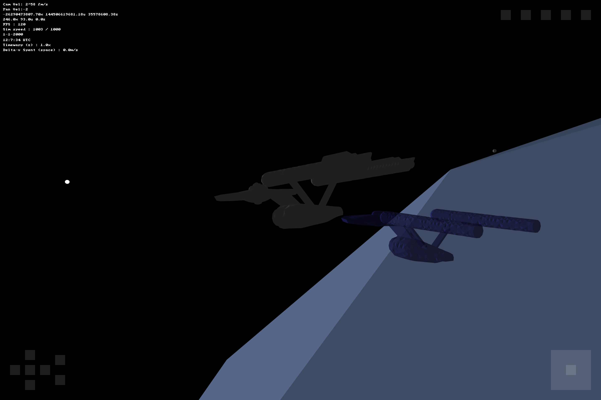

# Astronautical-Engineering-Simulator

## About
This is only really on Github so I can host a website demo to show off; this is a heavy work in progress and was basically just started (for fun). The idea is that, while I learn cool engineering stuff during my mechanical engineering undergrad (e.g., thermodynamics), I can use this as a study guide of sorts by implementing what I learn, here.

## Acknowledgments
This project uses SDL3 and cglm--both pretty cool projects (AES initially used GL4ES too, but doesn't anymore, which is also a cool project you should check out)

## To-do List
0. Standardize conventions (I have no idea what I'm doing; no, I won't use A.I.)
1. ~~Fix multi-touch attempt~~ (done)
2. ~~Actually load object data into some world space (using 128bit integer coordinates; 1fm blocks out to 3.4 * 10^7 LY)~~
3. Test out Swartzchild n-body gravity (no idea if my implementation is right; use fp32 for math using 128bit coords)
4. Gravity simulation using cells (i.e., allow for galaxy/universe-scale gravity; use with n-body at small scales)
5. ~~Fix web demo (web demo is currently behind, as this program is mixed shaders/FFP)~~
6. AABB bounding boxes
7. Culling of objects < 1 pixel or behind camera (using AABB bounding)
8. 1D elements (import & new vertex shader) for circuits and springs
9. 2D elements (import)
10. indexed rendering
---
## Using the Program
If you just want to run the program, using a machine running some typical desktop GNU Linux distro:
1. Download the entire repo, minus the minus the ".html", ".js", and ".wasm" files in the root directory
2. Run the "AES" file like any other executable file/program (you may need to add permissions with "chmod +x ./AES" from a terminal in the downloaded folder)
3. Load 3D FEM meshes by generating them first with NetGen or Gmsh in FreeCAD, then export them as "FEM FENICS MESH" into AES's "meshes" folder, then change "char model_file[]" to equal its file name
4. For a "demo", see https://leowhite-goose.github.io/Astronautical-Engineering-Simulator/
---
## Compiling and Running the Program (by platform)
### tl;dr
    1. - gcc src/main/main.c -o AES -lSDL3 -lGL -lm -O3 -g
    2. - x86_64-w64-mingw32-gcc src/main/main.c -o AES -lSDL3 -lopengl32 -lm -O3 -g
    3. - emcc src/main/main.c -o index.js --use-port=sdl3 -sMIN_WEBGL_VERSION=2 -sMAX_WEBGL_VERSION=2 -sFULL_ES3 -s INITIAL_MEMORY=1024mb -s TOTAL_STACK=128mb -DSDL_THREADS-ON -pthread -sPTHREAD_POOL_SIZE=navigator.hardwareConcurrency --embed-file data/icon.png --embed-file meshes/TOS-rip-FEMMeshGmsh002.xml --embed-file meshes/TOS-Enterprise-G14.xml --embed-file meshes/Sphere_Diameter=1_Low.xml --embed-file src/graphics/vertex_shader.glsl --embed-file src/graphics/fragment_shader.glsl --embed-file src/graphics/gui_vertex_shader.glsl --embed-file src/graphics/gui_fragment_shader.glsl --embed-file src/graphics/non_lit_fragment_shader.glsl -O3 -g
    4. - aarch64-linux-gnu-gcc src/main/main.c -o AES -lSDL3 -lGL -lm -O3 -g
### Compiling for GNU Linux (from Fedora Linux)
1. run either one of the following from a terminal to build/compile the code: (first two --> x86, last --> arm64; second = main)
    - clang src/main/main.c -o AES -lSDL3 -lGL -lm -O3 -g
    - run #1 in tl;dr section above
        - both require fedora's "SDL3-devel" or equivalent package
    - run #4 in tl;dr section above
        - requires fedora's gcc-aarch64-linux-gnu.x86_64 or equivalent package
        
2. to run the program (or just double click the file generated from above)
    - ./AES

### Compiling Windows Port (from Fedora Linux)
1. Using Fedora linux, install mingw64-gcc && mingw64-SDL3
2. Run: run #2 in tl;dr section above
    
### Compiling for Emscripten (from GNU Linux)
1. search "emscripten" and go through the intro steps for setting it up; you'll its commands to run the following:
2. to build:
    - run #3 in tl;dr section above
        - note: build command below targets "index.js" and leaves "index.html" untouched; target "index.html" to regen all website-related files
3. to run a server to host the generated site:
    - emrun ./index.html                        // starts server & auto-opens a tab w/ default browser

---
## Notes & Contributing (or not)
I just started using Github with this project and am using it to learn programming & mechanical engineering; I probably won't accept pull or merge requests as I don't really know how they work and don't feel like it. Additionally, the project was created entirely without the use of generative A.I. (minor caveat: I didn't know DeepWiki was A.I. generated until recently; I don't remember it being particularly helpful and won't be using it going forward but I did refer to it once in an old code comment :/); this is evident in that no half-decent chatbot would write code this ~~poorly~~ "creatively" with purely hypothetical guidelines and consistency (the old art of adding one thing at a time, ~randomly, and seeing if everything collapses).

### Using Git (because I forget)
Examples of basic commands:
- git add . <-- adds all changes
- git add example.txt
- git rm example.txt
- git commit -m "removed example.txt"
- git status
- git push origin main
- git config --global user.email "user@domain"
    - check with git config --list
- git remote add origin URL
    - check with git remote -v 
